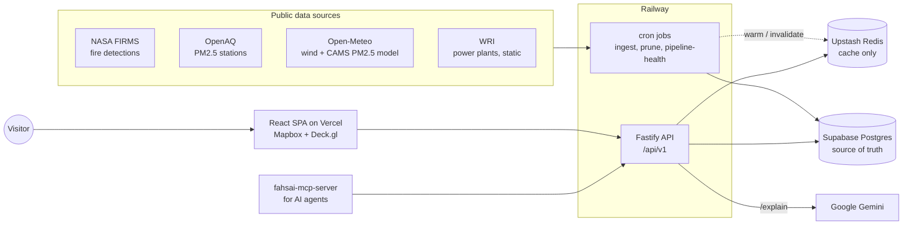

# Fahsai architecture

Fahsai ([fahsai.fyi](https://fahsai.fyi)) is a map of what drives air pollution in Thailand and its
neighbours: satellite fire detections, ground PM2.5 stations, a modelled PM2.5 grid and wind, for
any day in the last 120 days. A visitor can ask an AI model to explain a station's reading from
that same data.

This page is the overview: the moving parts, how data flows through them, what happens when one
of them fails, and what it costs. The reasoning behind specific choices is in the
[architecture decision records](adr/README.md). Detailed reference material (routes, schema,
conventions) is in [docs/claude/](claude/), which is written for coding agents working on the repo.

## Context

- **Ingest** runs as separate Railway cron jobs, one per source and step. Each fetches one day,
  writes it to Supabase, then warms or clears the matching Redis key.
- **Supabase** holds everything. The browser never connects to it: only the API and the crons do,
  with a service-role key ([ADR 0004](adr/0004-backend-only-db-access-and-redis-cache-aside.md)).
- **The API** (Fastify, TypeScript) serves read-only JSON for the map. Responses for past days are
  immutable, so they're cached in Redis for 7 days and marked `Cache-Control: immutable`.
- **The frontend** (React, Vite) draws the layers with Deck.gl over a Mapbox base map. The PM2.5
  grid is interpolated in a Web Worker.
- **`/api/explain`** builds a structured context for one station on one day (trend, wind, a
  72-hour backward trajectory, upwind fires, cities and power plants, nearby stations) and streams
  a plain-language explanation from Gemini. The same context is available without the model at
  `/api/v1/explain/context`, which the separate
  [fahsai-mcp-server](https://github.com/JoostKiens/fahsai-mcp-server) package uses.

## Daily data flow

All times UTC. Bangkok is UTC+7, so "yesterday" in the app is the Bangkok calendar day.

| Time         | Job                                                                  | Writes                                                                            |
| ------------ | -------------------------------------------------------------------- | --------------------------------------------------------------------------------- |
| 23:00        | `ingest-cams`, `ingest-station-readings` pass 1                      | CAMS PM2.5 grid (4,599 points), station daily averages                            |
| 01:00        | `ingest-fallback-cams`                                               | Re-runs CAMS if the grid is incomplete                                            |
| 02:00        | `ingest-weather-readings`, `prune`                                   | Wind and weather grid, plus per-station weather; deletes rows older than 140 days |
| 04:00        | `ingest-station-readings` pass 2, `ingest-weather-readings-fallback` | Final station averages; re-runs weather if incomplete                             |
| 04:30        | `ingest-station-fire-pressure`                                       | Fire count and FRP within 75 km of each station, over 14 days                     |
| 04:40        | `ingest-station-baseline`                                            | Seasonal PM2.5 baseline for stations that don't have one yet                      |
| 06:00        | `pipeline-health`                                                    | Checks yesterday is complete and the API is healthy (see below)                   |
| 10:00, 23:00 | `ingest-fires`                                                       | NASA VIIRS fire detections; the second run catches late publishing                |
| Monthly      | `ingest-stations`                                                    | OpenAQ station metadata                                                           |

The app shows the newest day that is **complete**: a full CAMS grid, a full wind grid and at
least one station reading. `/api/latest-date` checks this, so a day with a failed ingest is skipped
rather than shown half-empty. Yesterday's data usually appears by about 06:30 Bangkok time. Why
OpenAQ runs twice and CAMS once is in [ADR 0001](adr/0001-two-pass-ingest-schedule.md).

## Key trade-offs

1. **Free-tier storage sets the history window.** Supabase's free tier allows 500 MB, so every
   time series is pruned at 140 days, enough for the 120-day scrubber plus explain's look-back
   ([ADR 0005](adr/0005-140-day-retention.md)).
2. **One trust boundary, plus a cache.** Only the backend touches the database, and Redis sits in
   front of it for the immutable daily payloads. The price is a powerful service-role key on the
   server ([ADR 0004](adr/0004-backend-only-db-access-and-redis-cache-aside.md)).
3. **Redis may fail; the map may not.** Cache, rate limiter and quota all fail open, so an Upstash
   outage makes the map slower, not broken ([ADR 0006](adr/0006-upstash-failures-fail-open.md)).
4. **Spatial work in TypeScript, not PostGIS.** All database queries are bounding boxes; distances,
   trajectories and radii are computed in tested application code
   ([ADR 0003](adr/0003-plain-lat-lng-no-postgis.md)).
5. **Freshness vs completeness.** Ingest is scheduled so yesterday is visible by Bangkok morning,
   but a day only appears once it's complete, which costs a second OpenAQ pass and fallback runs
   ([ADR 0001](adr/0001-two-pass-ingest-schedule.md)).

## Failure modes

| What fails                                     | What visitors see                                            | How it's noticed                                                                               |
| ---------------------------------------------- | ------------------------------------------------------------ | ---------------------------------------------------------------------------------------------- |
| An ingest cron                                 | The map keeps showing the last complete day                  | The cron reports to Rollbar; `pipeline-health` reports yesterday as incomplete                 |
| Upstash (outage, or stopped at its $20 budget) | Slower responses, served from Supabase                       | `/health` reports `cache: "error"`; `pipeline-health` alerts                                   |
| Supabase over 500 MB                           | Read-only database: ingest fails, the map shows an older day | Crons report `INSERT` failures; `pipeline-health` reports the day incomplete                   |
| Supabase or API down                           | Retries, then a "Some data could not be loaded" message      | `/health` returns 503; `pipeline-health` alerts                                                |
| Railway stopped (hard spending limit hit)      | API down, no new data                                        | `pipeline-health` doesn't run, so its Healthchecks.io ping is missing and that alerts by email |
| Gemini rate limit or quota                     | The explain button says to try later                         | Logged; not an outage                                                                          |

`pipeline-health` runs daily at 06:00 UTC, reports problems to Rollbar and pings a
Healthchecks.io dead-man's switch (`docs/claude/architecture.md` has the details).

## Cost

About **$5 a month**, almost all of it Railway's Hobby plan. Supabase, Vercel, Rollbar, Gemini and
Healthchecks.io are on free tiers that can't bill. Upstash and Mapbox are pay-as-you-go but cost
cents at current traffic. Every billable service has a cap or alert, and each one's behaviour at
its cap is recorded in [docs/claude/costs.md](claude/costs.md).

## Repository layout

A pnpm monorepo:

- `packages/frontend`: the React SPA (Vercel)
- `packages/backend`: the Fastify API and every cron job (Railway). `src/scripts/` holds the cron
  entry points, and `src/jobs/` the logic they run.
- `packages/types`, `packages/consts`: types and constants shared by both
- `supabase/migrations`: schema as migrations, checked against a snapshot in CI
- `.railway/railway.ts`: Railway services and cron schedules as code
